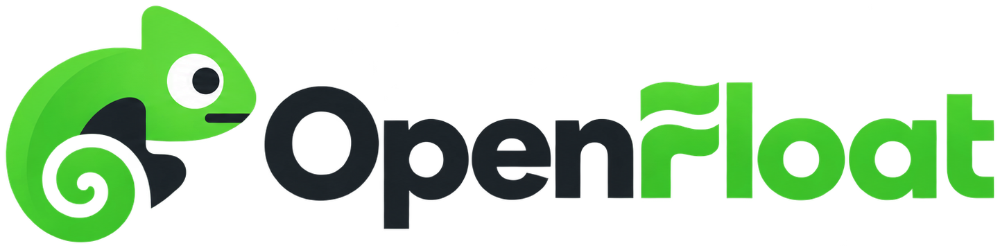

# OpenFloat (lbaw2621)

{width="480"}

> We make CS2 item trading simpler and safer for everyone. Buy, sell, auction, and discover items for your collection.

OpenFloat is a web marketplace where Counter-Strike 2 players buy, sell, collect, and trade skins through auctions and fixed-price listings. Sellers list items from their synced Steam inventory, buyers bid or buy directly, and the system closes auctions automatically at their current deadline.

Course project for LBAW 26/27 (Database and Web Applications Laboratory, LEIC, FEUP and FCUP, U.Porto). Group 2621.

## Main features

* Steam sign-in and Steam inventory sync, listings use owned items only.
* Auctions with starting price, deadline, bidding history, and automatic closing.
* Deadline extension: an accepted bid in the final 15 minutes adds 30 minutes.
* Fixed-price listings with direct purchase and bargain offers (project scope in A2).
* Browse active auctions, search by keyword, filter by weapon, category, price, exterior, float range, rarity, paint seed, and StatTrak or Souvenir status.
* Follow auctions, bidding history, purchase and sales tracking, seller ratings after completed purchases.
* Credit wallet with reservations for leading bids.
* Notifications for new bids, ending and ended auctions, stopped auctions, winners, and deleted followed auctions.
* Separate admin area for auction moderation, user blocking, content removal, and report handling. Admin accounts cannot trade or bid.

## Tech stack

Per course rules: GitLab, PostgreSQL, PHP with Laravel, Docker, HTML, CSS, JavaScript. Additional libraries require teacher approval.

## Repository status

Work in progress. This repository currently holds project documentation. The vertical prototype will build on the supplied LBAW prototype and must include authentication, user management, and at least one non-trivial module.

Remote: `https://gitlab.up.pt/lbaw/lbaw2627/lbaw2621.git`

## Documentation

Specifications live in the project wiki:

* ER: Requirements Specification (A1 project presentation, A2 actors and user stories, A3 information architecture)
* EBD: Database Specification (A4 conceptual model, A5 relational schema, A6 indexes, triggers, transactions, population)
* EAP: Architecture Specification and Prototype (A7 web resources, A8 vertical prototype)
* PA: Product and Presentation (A9 product, A10 presentation)

Full functional detail is in `online-auctions.md` and `project-rules.md` at the parent folder, and in wiki pages `er/a1.md` and `er/a2.md`.

## Team

* Rodrigo Fernandes Teixeira, up202404802@up.pt
* Rodrigo Martins Dias, up202404130@up.pt
* Viacheslav-Illia Detsyk, up202412740@up.pt
* Pedro Miguel Malhão de Meireles, up202306104@up.pt

GROUP2621, 24/9/2026
