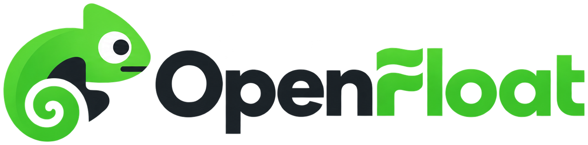

  <picture>
    <source media="(prefers-color-scheme: dark)" srcset="assets/logo-full-dark.svg">
    
  </picture>

<h3 align="center">An open-source marketplace for Counter-Strike 2 items.</h3>

  
  
   
  
  
  

Discover skins, bid in auctions and buy or sell at a fixed price. OpenFloat is a marketplace we are building in the open.

## Why OpenFloat?

- **Open source:** A marketplace others can learn from and build on.
- **Made for collectors:** Find items by float, paint seed, exterior and more.

## Status

OpenFloat is in early development. The marketplace is not live yet, and these features are planned. Star the repo to follow along.

## Team

Built for LBAW 2026/27 at FEUP and FCUP, University of Porto, by:

- Rodrigo Fernandes Teixeira
- Rodrigo Martins Dias
- Viacheslav-Illia Detsyk
- Pedro Miguel Malhão de Meireles

## License

[MIT](LICENSE)
